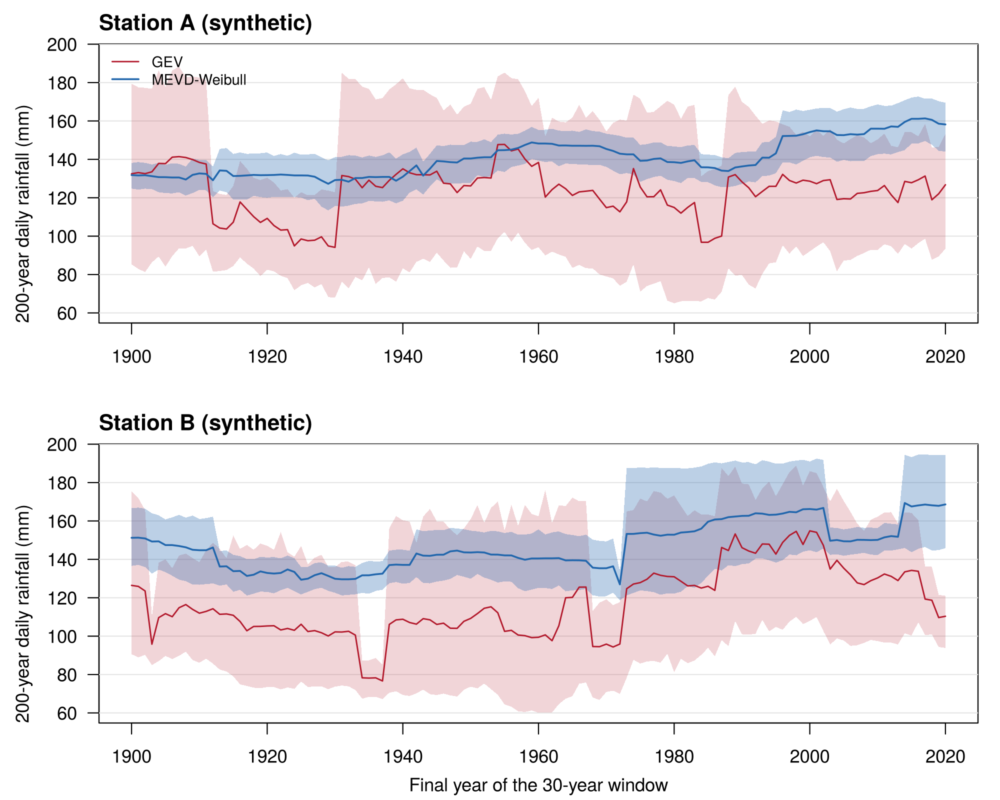
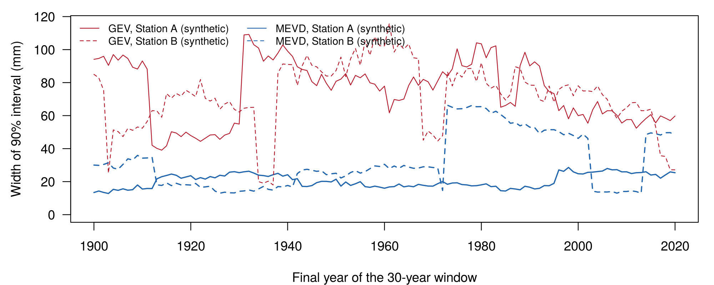

# Rainfall extremes: GEV vs MEVD in moving windows

How stable are estimates of rare daily rainfall when they come from only 30 years of data?
This repository estimates the **200-year daily rainfall** in moving 30-year windows with two methods and compares how much each estimate moves and how uncertain it is.

- **GEV**: generalised extreme value distribution fitted to the 30 annual maxima, using L-moments.
- **MEVD**: metastatistical extreme value distribution, built from *all* wet days of each year, with a Weibull distribution for daily rainfall above 1 mm.


*Synthetic example: 200-year daily rainfall in 30-year windows, with 90% bootstrap intervals. Station B has a 20% increase in the scale of wet-day rainfall over its last 60 years.*

## Method

1. **Valid years**: a year is used if it has at least 360 days of data. For each year we keep the annual maximum, the number of wet days *N* (rain > 1 mm) and a Weibull fit (scale *C*, shape *w*) of the wet-day excesses, using probability weighted moments.
2. **Windows**: 30-year windows moved by one year. A window is kept if it has at least 20 valid years.
3. **GEV**: L-moment fit to the annual maxima of the window (Hosking, 1990), then the quantile with non-exceedance probability 1 − 1/200.
4. **MEVD**: the distribution of the annual maximum is the average over the *n* years of the window
   $$F(x) = \frac{1}{n}\sum_{j=1}^{n}\left[1 - e^{-(x/C_j)^{w_j}}\right]^{N_j}$$
   (Marani & Ignaccolo, 2015; Zorzetto et al., 2016). The 200-year value is found with a root solver, and the 1 mm threshold is added back.
5. **Uncertainty**: 500 bootstrap samples of the years in each window. The same resampled years are used for both methods, so their intervals are directly comparable. The 5th and 95th percentiles give a 90% interval.

The MEVD uses every wet day, not only one value per year, so its estimates are usually much more stable than the GEV's: in the synthetic example the median 90% interval is about 75 mm wide for the GEV and 20–30 mm for the MEVD.



### Relation to MEVpy

The GEV, Weibull and MEVD equations are the standard published ones, also used in [MEVpy](https://github.com/EnricoZorzetto/mevpy). The analysis around them is my own:

| | This repository (R) | MEVpy `slideover` (Python) |
| --- | --- | --- |
| Window position | final year of the window | central year |
| Incomplete years | year kept only with ≥ 360 days; window kept only with ≥ 20 valid years | no check |
| Ordinary events | rain > 1 mm, fitted as excesses, threshold added back | rain > 0 mm |
| GEV uncertainty | bootstrap of years | asymptotic (Hessian) |
| MEVD uncertainty | bootstrap of years | bootstrap of daily values within years |
| Comparability | the same resampled years for GEV and MEVD | separate methods |
| MEVD quantile | bracketed root search (`uniroot`) | `fsolve` from a starting guess |

## How to run

Requires R (base packages only).

```bash
Rscript example/make_synthetic_data.R   # writes two synthetic stations to data/
Rscript R/run_analysis.R                # results in results/, figures in figures/
```

To use your own stations, edit `STATIONS` at the top of `R/run_analysis.R`. Three input formats are supported (see `R/functions.R`):

| Reader | Format |
| --- | --- |
| `read_daily_csv` | CSV with columns `date` (YYYY-MM-DD) and `rain_mm` |
| `read_ghcn` | GHCN-Daily CSV export (`DATE` as YYYYMMDD, `PRCP` in tenths of mm) |
| `read_year_blocks` | text file: a year number followed by that year's daily values |

Settings (return period, window length, wet-day threshold, number of bootstrap samples) are at the top of `R/functions.R`.

## Files

```
R/functions.R                 fitting, windows, bootstrap, plots
R/run_analysis.R              runs the analysis for the listed stations
example/make_synthetic_data.R synthetic daily rainfall for testing
figures/                      figures of the synthetic example
```

## Data

The data shipped here are **synthetic** and are only meant to show how the code works. I first wrote this code for an analysis of two long Italian daily rainfall records; those records are not public and are not included.

## References

- Greenwood, J. A., Landwehr, J. M., Matalas, N. C., & Wallis, J. R. (1979). Probability weighted moments. *Water Resources Research*, 15(5), 1049–1054.
- Hosking, J. R. M. (1990). L-moments: analysis and estimation of distributions using linear combinations of order statistics. *Journal of the Royal Statistical Society B*, 52(1), 105–124.
- Hosking, J. R. M., Wallis, J. R., & Wood, E. F. (1985). Estimation of the generalized extreme-value distribution by the method of probability-weighted moments. *Technometrics*, 27(3), 251–261.
- Marani, M., & Ignaccolo, M. (2015). A metastatistical approach to rainfall extremes. *Advances in Water Resources*, 79, 121–126.
- Zorzetto, E., Botter, G., & Marani, M. (2016). On the emergence of rainfall extremes from ordinary events. *Geophysical Research Letters*, 43, 8076–8082.
- The Python package [MEVpy](https://github.com/EnricoZorzetto/mevpy) by Enrico Zorzetto was the reference for the MEVD equations; this repository is an independent implementation in R.

## Author

Fatemeh Arab Sadeghabadi, MSc in Water and Geological Risk Engineering, University of Padova.
